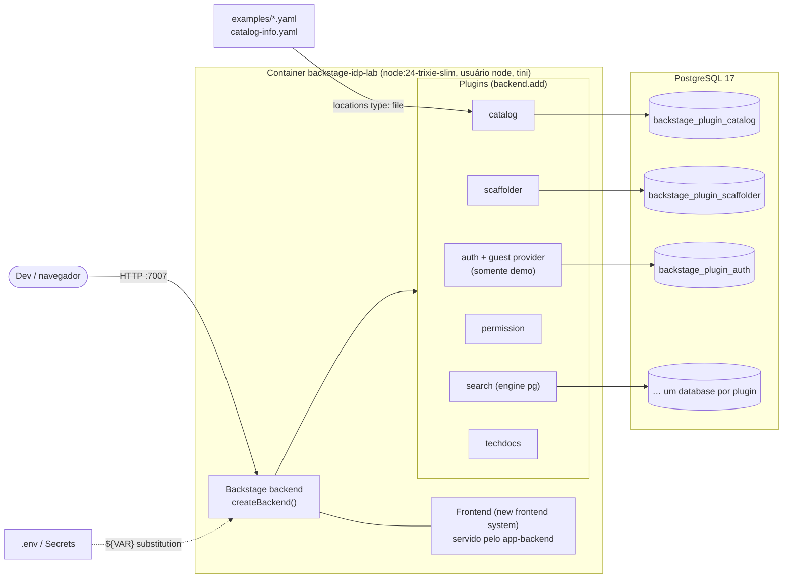

# backstage-idp-lab

Laboratório de **Platform Engineering com Backstage** pensado para a realidade de uma IDP (Internal Developer Platform) em uma empresa regulada do setor financeiro/seguros — no contexto do time **FastFlow**.

O objetivo é mostrar, de ponta a ponta, o que um(a) Platform Engineer sênior faz no Backstage: arquitetura do framework (novo backend system), catálogo como fonte de verdade de ownership, golden paths com governança, e autorização baseada em ownership.

> Código, identificadores e descritores em inglês; documentação em pt-BR.

## Status e roadmap

O laboratório é entregue em etapas, **um PR por etapa**:

| Etapa | Entrega                                                                                                                                                                       | Status     |
| ----- | ----------------------------------------------------------------------------------------------------------------------------------------------------------------------------- | ---------- |
| 1     | Backstage (novo backend system) + PostgreSQL via docker-compose, Dockerfile multi-stage, `app-config` com variáveis de ambiente, catálogo de exemplo com dois+ times, CI      | ✅ este PR |
| 2     | Plugin backend customizado (SonarQube/GitHub API via `coreServices`, modo mock offline) + card de frontend na página da entidade                                              | ⏳ próximo |
| 3     | Custom Scaffolder Action (`createTemplateAction`) validando regras corporativas (nomenclatura, owner existente, tier/criticidade/classificação de dados) + golden path NestJS | ⏳         |
| 4     | `PermissionPolicy` customizada com decisões condicionais por ownership (`isEntityOwner`) + mapeamento de claims OIDC (Entra ID / Keycloak)                                    | ⏳         |

## Arquitetura (etapa 1)



Pontos de arquitetura que valem discutir em entrevista:

- **Novo backend system**: `packages/backend/src/index.ts` só compõe features com `backend.add(import(...))`. Cada plugin recebe dependências por injeção (`coreServices.database`, `logger`, `httpRouter`, `auth`...), sem wiring manual — é o que permite adicionar módulos (`createBackendModule`) nas próximas etapas sem tocar nos plugins.
- **Novo frontend system**: `packages/app/src/App.tsx` usa `createApp` de `@backstage/frontend-defaults` com features/extensions; `app.packages: all` descobre os plugins pelas dependências do pacote `app`.
- **PostgreSQL em todos os ambientes** (inclusive dev): o comportamento do catálogo (fila do `refresh_state`, stitching, locks) é o mesmo da produção. Cada plugin ganha seu próprio database lógico `backstage_plugin_<pluginId>`, criado automaticamente — por isso o usuário precisa de `CREATEDB` (ou use `pluginDivisionMode: schema` quando o DBA não concede isso).
- **Identidade = catálogo**: o guest provider faz `signInWithCatalogUser`, então o token já sai com `ownershipEntityRefs` (usuário + grupos de `memberOf`). É exatamente o contrato que o OIDC corporativo vai cumprir na etapa 4.

## Stack

| Item              | Versão                                                                   |
| ----------------- | ------------------------------------------------------------------------ |
| Backstage release | 1.56.0 (`backstage.json`), gerado com `npx @backstage/create-app@latest` |
| Node.js           | 22 ou 24 (imagem: `node:24-trixie-slim`)                                 |
| Yarn              | 4 (via Corepack, `yarnPath` versionado)                                  |
| PostgreSQL        | 17                                                                       |
| TypeScript        | ~5.8                                                                     |

## Estrutura

```
.
├── packages/
│   ├── app/                 # frontend (new frontend system)
│   └── backend/             # backend (createBackend) + teste do catálogo
├── plugins/                 # plugins internos (etapas 2–4)
├── examples/
│   ├── org.yaml             # Groups e Users
│   ├── entities.yaml        # Domains, Systems, Components, APIs, Resources
│   └── template/            # template de exemplo (substituído na etapa 3)
├── catalog-info.yaml        # o próprio portal no catálogo
├── app-config.yaml          # base (dev) com ${VAR:-default}
├── app-config.production.yaml  # overlay de produção (somente env vars)
├── app-config.docker.yaml   # overlay da demo local (habilita guest no container)
├── Dockerfile               # build multi-stage
├── docker-compose.yml       # Postgres + Backstage
└── .github/workflows/ci.yml # CI
```

## Como rodar

Pré-requisitos: Docker com Compose v2. Para desenvolvimento local, também Node 22/24 e Corepack (`corepack enable`).

### Opção A — tudo em containers (recomendado para demo)

```bash
cp .env.example .env          # ajuste POSTGRES_PASSWORD se quiser
docker compose up --build     # primeira build leva alguns minutos
# abra http://localhost:7007 e entre como "Guest"
```

O `docker compose` sobe o Postgres, espera o healthcheck (`pg_isready`) e só então inicia o Backstage, que tem seu próprio `HEALTHCHECK` em `/.backstage/health/v1/readiness`.

Trocar de identidade (para demonstrar ownership/permissões):

```bash
BACKSTAGE_GUEST_USER=user:default/bruno.lima docker compose up -d
```

### Opção B — desenvolvimento local (hot reload)

```bash
cp .env.example .env
docker compose up -d postgres          # só o banco
yarn install
set -a && source .env && set +a        # exporta as variáveis para o processo
yarn start                             # frontend :3000, backend :7007
```

> **Atenção com `GITHUB_TOKEN`**: deixe a linha **comentada** no `.env` quando não usar. O Backstage rejeita strings vazias em config (`got empty-string, wanted string`) e o backend não sobe; uma variável ausente simplesmente remove a chave. O `docker-compose.yml` lê tokens opcionais via `env_file` justamente para não repassar valores vazios.

### Comandos de qualidade

```bash
yarn tsc:full        # type check completo
yarn lint:all        # ESLint em todos os pacotes
yarn prettier:check
yarn test:all        # Jest (inclui a validação do catálogo)
yarn build:all       # build de todos os pacotes
```

## Configuração e segredos

- `app-config.yaml` usa substituição com fallback (`${POSTGRES_HOST:-localhost}`), então o mesmo arquivo funciona no laptop e no container.
- `app-config.production.yaml` contém **apenas** referências a variáveis de ambiente; em Kubernetes/OpenShift elas vêm de `Secret`/`ConfigMap` (idealmente sincronizados de AWS Secrets Manager ou Vault via External Secrets). TLS do Postgres via `PGSSLMODE`/CA montada está documentado no arquivo.
- `app-config.docker.yaml` é **somente para a demo**: habilita `dangerouslyAllowOutsideDevelopment` do guest provider. Em produção o sign-in é OIDC (etapa 4).
- `.env` é ignorado pelo Git; `.env.example` não tem segredos reais.

## Catálogo de exemplo

| Time (Group)          | Membros                  | Domínio / Sistema                 | Componentes                                                                                            |
| --------------------- | ------------------------ | --------------------------------- | ------------------------------------------------------------------------------------------------------ |
| `fastflow` (Platform) | thiago.braga             | developer-platform / fastflow-idp | backstage-idp-lab                                                                                      |
| `claims-squad`        | ana.souza                | claims / claims-processing        | claims-api, fraud-scoring-worker, claims-portal (+ API claims-api, resources claims-db, claims-events) |
| `policy-squad`        | bruno.lima, carla.mendes | policy / policy-quoting           | policy-quote-service, broker-quote-widget (+ API policy-quote-api, resource policy-db)                 |

Todos os `Component` carregam anotações de governança usadas nas próximas etapas:

```yaml
fastflow.io/tier: tier-1 # tier-1 | tier-2 | tier-3
fastflow.io/criticality: high # low | medium | high
fastflow.io/data-classification: confidential # public | internal | confidential | restricted
```

O teste `packages/backend/src/catalog.test.ts` roda no CI e falha se: alguma entidade não passar no schema do `@backstage/catalog-model`, algum `owner`/`memberOf` apontar para um Group inexistente, ou algum Component não tiver as anotações de governança. Em produção a lista de Users/Groups não é escrita à mão: vem de um Entity Provider do diretório corporativo (`catalog-backend-module-msgraph` para Entra ID, ou o provider do Keycloak).

## Roteiro de demo (etapa 1)

1. `docker compose up --build` e mostrar o `HEALTHCHECK` ficando `healthy` (`docker compose ps`).
2. Entrar como Guest → o token representa `user:default/ana.souza` com ownership de `group:default/claims-squad`. Para mostrar o que vai no token:
   ```bash
   curl -s -H 'X-Requested-With: XMLHttpRequest' http://localhost:7007/api/auth/guest/refresh | jq .backstageIdentity.identity
   # { "userEntityRef": "user:default/ana.souza",
   #   "ownershipEntityRefs": ["user:default/ana.souza", "group:default/claims-squad"] }
   ```
3. Catálogo: filtrar por owner `claims-squad`, abrir `claims-api` e mostrar relações (`providesApis`, `consumesApis`, `dependsOn`), a aba de API com o OpenAPI renderizado e o grafo de dependências.
4. Abrir o Group `policy-squad` e mostrar a visão de ownership do time.
5. Bastidores no Postgres — o que acontece no ciclo de ingestão:
   ```bash
   docker compose exec postgres psql -U backstage -d backstage_plugin_catalog
   \dt
   select entity_ref, next_update_at, errors from refresh_state order by next_update_at limit 5;
   select source_entity_ref, type, target_entity_ref from relations where source_entity_ref = 'component:default/claims-api';
   ```
   Discussão: `refresh_state` (fila de processamento/reconciliação), `stitch_queue` + `final_entities` (stitching), `relations`, `search` (índice usado pelos filtros).
6. Reiniciar como `bruno.lima` (`BACKSTAGE_GUEST_USER`) e mostrar que o ownership no token muda — base para a `PermissionPolicy` da etapa 4.

## Próximos passos (fora desta etapa)

- **Etapa 2**: plugin `code-quality` (backend + card no `EntityPage`) consultando SonarQube Web API e GitHub API, com cache e modo mock offline.
- **Etapa 3**: action `fastflow:governance:validate` + template NestJS (golden path) com `fetch:template` e `catalog:register`, opcionalmente disparando `workflow_dispatch` no GitHub Actions.
- **Etapa 4**: `PermissionPolicy` via `policyExtensionPoint` com `createCatalogConditionalDecision`/`isEntityOwner`, e sign-in OIDC (Entra ID / Keycloak) mapeando claims de grupos para o catálogo.
- Depois: TechDocs com publisher S3 e build no CI, plugins ArgoCD/SonarQube, OpenTelemetry, deploy em Kubernetes/OpenShift (probes, HPA, réplicas stateless) e métricas DORA/adoção.
