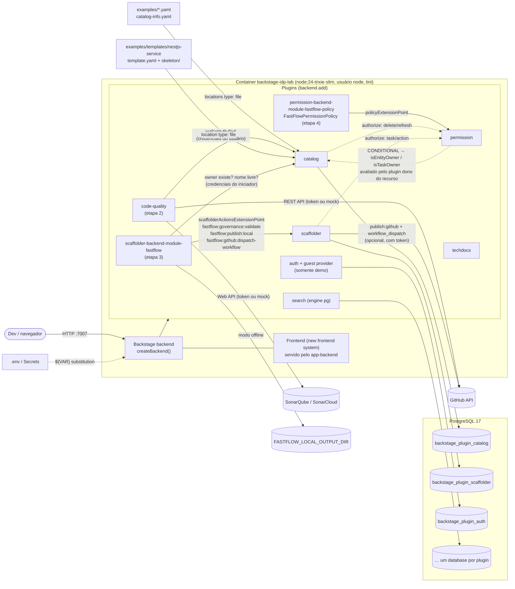
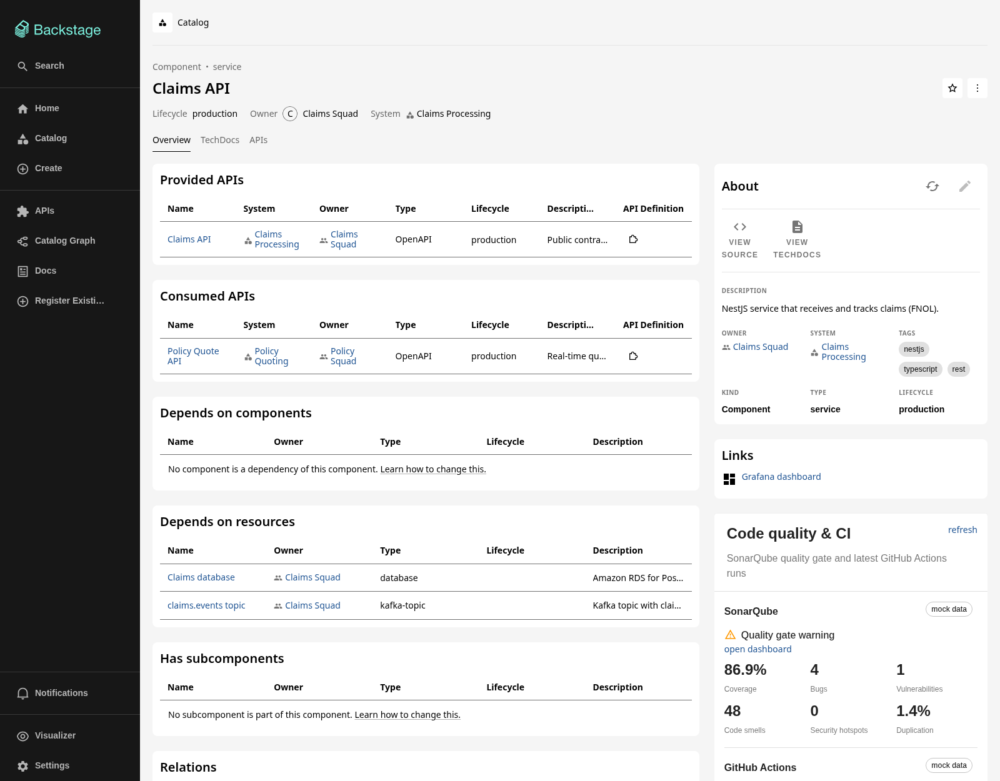
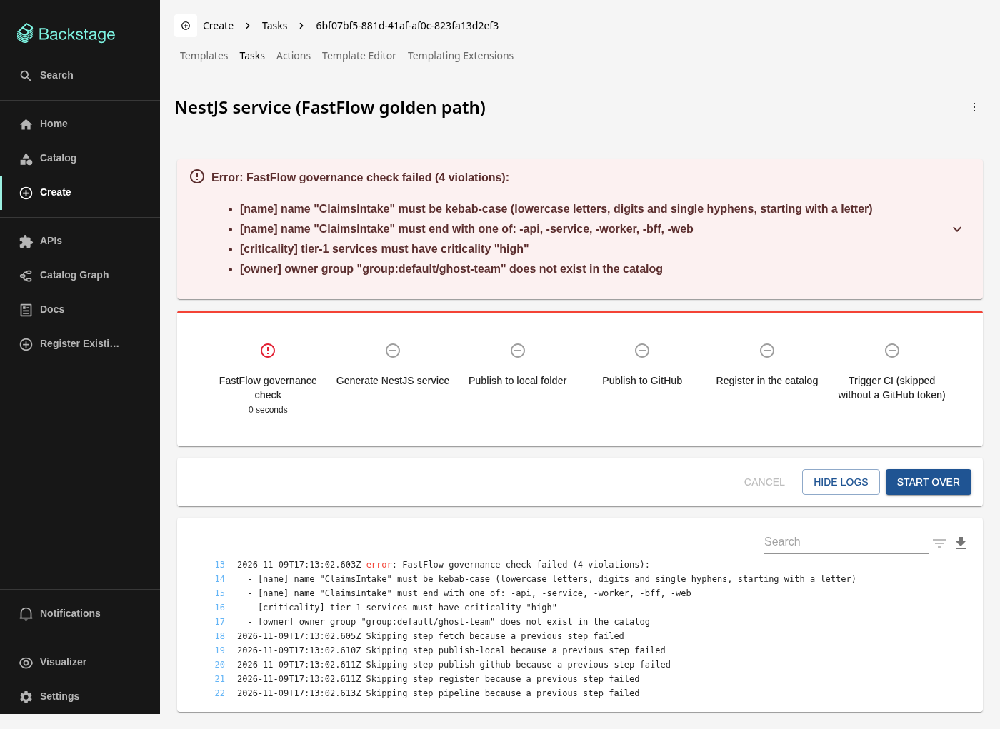
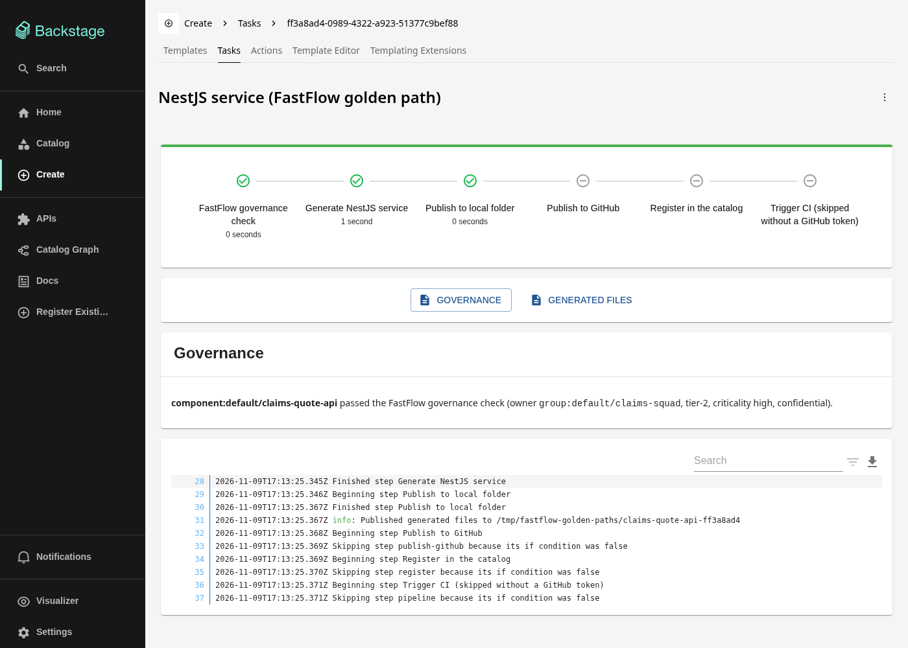
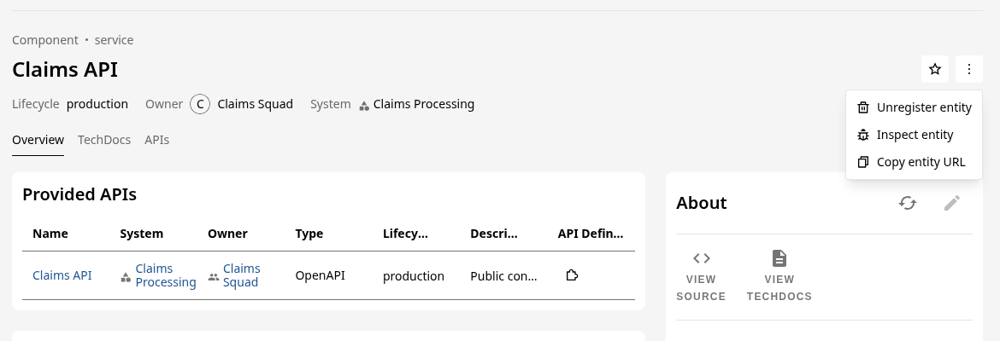
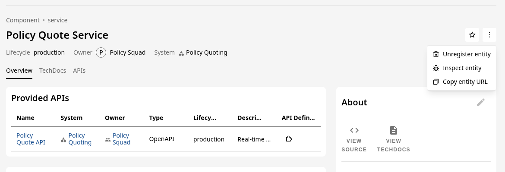
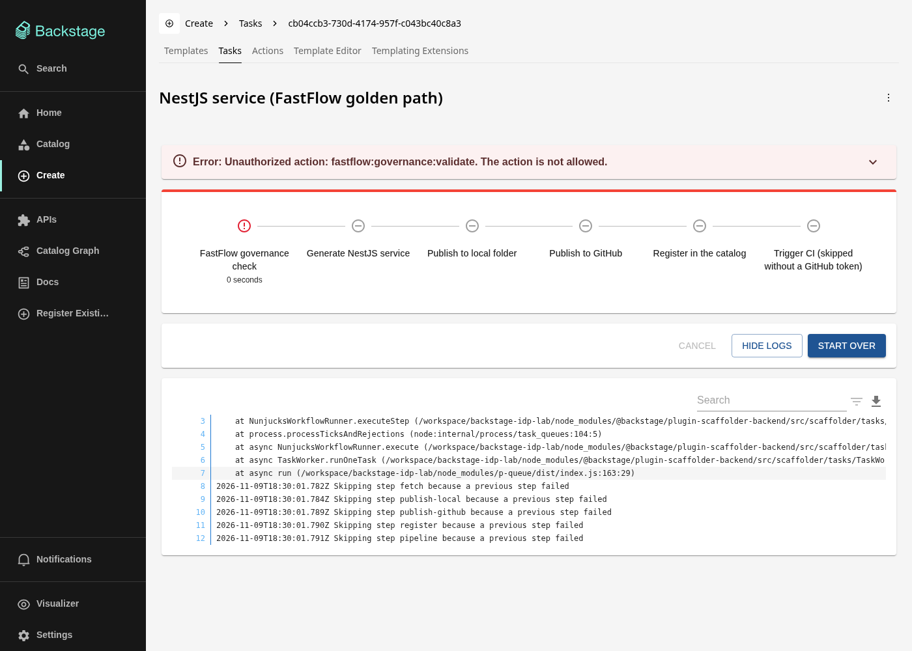

# backstage-idp-lab

Laboratório de **Platform Engineering com Backstage** pensado para a realidade de uma IDP (Internal Developer Platform) em uma empresa regulada do setor financeiro/seguros — no contexto do time **FastFlow**.

O objetivo é mostrar, de ponta a ponta, o que um(a) Platform Engineer sênior faz no Backstage: arquitetura do framework (novo backend system), catálogo como fonte de verdade de ownership, golden paths com governança, e autorização baseada em ownership.

> Código, identificadores e descritores em inglês; documentação em pt-BR.

## Status e roadmap

O laboratório foi entregue em etapas, **um PR por etapa** — as quatro estão concluídas:

| Etapa | Entrega                                                                                                                                                                       | Status     |
| ----- | ----------------------------------------------------------------------------------------------------------------------------------------------------------------------------- | ---------- |
| 1     | Backstage (novo backend system) + PostgreSQL via docker-compose, Dockerfile multi-stage, `app-config` com variáveis de ambiente, catálogo de exemplo com dois+ times, CI      | ✅ PR #1   |
| 2     | Plugin backend customizado (SonarQube/GitHub API via `coreServices`, modo mock offline) + card de frontend na página da entidade                                              | ✅ PR #2   |
| 3     | Custom Scaffolder Action (`createTemplateAction`) validando regras corporativas (nomenclatura, owner existente, tier/criticidade/classificação de dados) + golden path NestJS | ✅ PR #3   |
| 4     | `PermissionPolicy` customizada com decisões condicionais por ownership (`isEntityOwner`) + mapeamento de claims OIDC (Entra ID / Keycloak)                                    | ✅ este PR |

## Arquitetura



Pontos de arquitetura que valem discutir em entrevista:

- **Novo backend system**: `packages/backend/src/index.ts` só compõe features com `backend.add(import(...))`. Cada plugin recebe dependências por injeção (`coreServices.database`, `logger`, `httpRouter`, `auth`...), sem wiring manual — é o que permite adicionar módulos (`createBackendModule`) nas próximas etapas sem tocar nos plugins.
- **Novo frontend system**: `packages/app/src/App.tsx` usa `createApp` de `@backstage/frontend-defaults` com features/extensions; `app.packages: all` descobre os plugins pelas dependências do pacote `app`.
- **PostgreSQL em todos os ambientes** (inclusive dev): o comportamento do catálogo (fila do `refresh_state`, stitching, locks) é o mesmo da produção. Cada plugin ganha seu próprio database lógico `backstage_plugin_<pluginId>`, criado automaticamente — por isso o usuário precisa de `CREATEDB` (ou use `pluginDivisionMode: schema` quando o DBA não concede isso).
- **Identidade = catálogo**: o guest provider faz `signInWithCatalogUser`, então o token já sai com `ownershipEntityRefs` (usuário + grupos de `memberOf`). É exatamente o contrato que o OIDC corporativo cumpre em produção (ver [docs/identity-and-sso.md](docs/identity-and-sso.md)) e o insumo da `PermissionPolicy` da etapa 4.

## Stack

| Item              | Versão                                                                   |
| ----------------- | ------------------------------------------------------------------------ |
| Backstage release | 1.56.0 (`backstage.json`), gerado com `npx @backstage/create-app@latest` |
| Node.js           | 22 ou 24 (imagem: `node:24-trixie-slim`)                                 |
| Yarn              | 4 (via Corepack, `yarnPath` versionado)                                  |
| PostgreSQL        | 17                                                                       |
| TypeScript        | ~5.8                                                                     |

## Estrutura

```
.
├── packages/
│   ├── app/                 # frontend (new frontend system)
│   └── backend/             # backend (createBackend) + teste do catálogo
├── plugins/
│   ├── code-quality-backend/  # etapa 2: /api/code-quality (SonarQube + GitHub)
│   ├── code-quality/          # etapa 2: card da entidade (new frontend system)
│   ├── code-quality-common/   # etapa 2: tipos e anotações compartilhados
│   ├── scaffolder-backend-module-fastflow/  # etapa 3: actions de governança do golden path
│   │   └── src/
│   │       ├── governance/rules.ts          # regras puras (nome, tier, criticidade, dados)
│   │       ├── actions/                     # validate, publish:local, dispatch-workflow
│   │       └── module.ts                    # createBackendModule (scaffolder)
│   └── permission-backend-module-fastflow-policy/  # etapa 4: PermissionPolicy por ownership
│       └── src/
│           ├── policy/FastFlowPermissionPolicy.ts  # ALLOW / DENY / CONDITIONAL
│           └── module.ts                           # createBackendModule (permission)
├── examples/
│   ├── org.yaml             # Groups e Users
│   ├── entities.yaml        # Domains, Systems, Components, APIs, Resources
│   └── templates/
│       └── nestjs-service/  # etapa 3: golden path NestJS (template.yaml + skeleton/ Nunjucks)
├── docs/
│   ├── identity-and-sso.md  # etapa 4: guest hoje, Entra ID / Keycloak em produção
│   └── images/              # screenshots do README
├── catalog-info.yaml        # o próprio portal no catálogo
├── app-config.yaml          # base (dev) com ${VAR:-default}
├── app-config.production.yaml  # overlay de produção (somente env vars)
├── app-config.docker.yaml   # overlay da demo local (habilita guest no container)
├── Dockerfile               # build multi-stage
├── docker-compose.yml       # Postgres + Backstage
├── scripts/
│   ├── smoke-scaffolder.sh  # etapa 3: execução rejeitada + execução válida via API
│   └── smoke-permissions.sh # etapa 4: allow/deny com ana.souza, bruno.lima e thiago.braga
└── .github/workflows/ci.yml # CI
```

## Como rodar

Pré-requisitos: Docker com Compose v2. Para desenvolvimento local, também Node 22/24 e Corepack (`corepack enable`).

### Opção A — tudo em containers (recomendado para demo)

```bash
cp .env.example .env          # ajuste POSTGRES_PASSWORD se quiser
docker compose up --build     # primeira build leva alguns minutos
# abra http://localhost:7007 e entre como "Guest"
```

O `docker compose` sobe o Postgres, espera o healthcheck (`pg_isready`) e só então inicia o Backstage, que tem seu próprio `HEALTHCHECK` em `/.backstage/health/v1/readiness`.

Trocar de identidade (para demonstrar ownership/permissões):

```bash
BACKSTAGE_GUEST_USER=user:default/bruno.lima docker compose up -d
```

### Opção B — desenvolvimento local (hot reload)

```bash
cp .env.example .env
docker compose up -d postgres          # só o banco
yarn install
set -a && source .env && set +a        # exporta as variáveis para o processo
yarn start                             # frontend :3000, backend :7007
```

> **Atenção com `GITHUB_TOKEN`**: deixe a linha **comentada** no `.env` quando não usar. O Backstage rejeita strings vazias em config (`got empty-string, wanted string`) e o backend não sobe; uma variável ausente simplesmente remove a chave. O `docker-compose.yml` lê tokens opcionais via `env_file` justamente para não repassar valores vazios.

### Comandos de qualidade

```bash
yarn tsc:full        # type check completo
yarn lint:all        # ESLint em todos os pacotes
yarn prettier:check
yarn test:all        # Jest (inclui a validação do catálogo)
yarn build:all       # build de todos os pacotes
```

## Configuração e segredos

- `app-config.yaml` usa substituição com fallback (`${POSTGRES_HOST:-localhost}`), então o mesmo arquivo funciona no laptop e no container.
- `app-config.production.yaml` contém **apenas** referências a variáveis de ambiente; em Kubernetes/OpenShift elas vêm de `Secret`/`ConfigMap` (idealmente sincronizados de AWS Secrets Manager ou Vault via External Secrets). TLS do Postgres via `PGSSLMODE`/CA montada está documentado no arquivo.
- `app-config.docker.yaml` é **somente para a demo**: habilita `dangerouslyAllowOutsideDevelopment` do guest provider. Em produção o sign-in é OIDC — Entra ID ou Keycloak, ver [docs/identity-and-sso.md](docs/identity-and-sso.md).
- `.env` é ignorado pelo Git; `.env.example` não tem segredos reais.

## Catálogo de exemplo

| Time (Group)          | Membros                  | Domínio / Sistema                 | Componentes                                                                                            |
| --------------------- | ------------------------ | --------------------------------- | ------------------------------------------------------------------------------------------------------ |
| `fastflow` (Platform) | thiago.braga             | developer-platform / fastflow-idp | backstage-idp-lab                                                                                      |
| `claims-squad`        | ana.souza                | claims / claims-processing        | claims-api, fraud-scoring-worker, claims-portal (+ API claims-api, resources claims-db, claims-events) |
| `policy-squad`        | bruno.lima, carla.mendes | policy / policy-quoting           | policy-quote-service, broker-quote-widget (+ API policy-quote-api, resource policy-db)                 |

Todos os `Component` carregam anotações de governança usadas nas próximas etapas:

```yaml
fastflow.io/tier: tier-1 # tier-1 | tier-2 | tier-3
fastflow.io/criticality: high # low | medium | high
fastflow.io/data-classification: confidential # public | internal | confidential | restricted
```

O teste `packages/backend/src/catalog.test.ts` roda no CI e falha se: alguma entidade não passar no schema do `@backstage/catalog-model`, algum `owner`/`memberOf` apontar para um Group inexistente, ou algum Component não tiver as anotações de governança. Em produção a lista de Users/Groups não é escrita à mão: vem de um Entity Provider do diretório corporativo (`catalog-backend-module-msgraph` para Entra ID, ou o provider do Keycloak).

## Etapa 2 — plugin `code-quality` (SonarQube + GitHub)



Três pacotes, seguindo o layout recomendado de plugins do Backstage:

| Pacote                                            | Papel                                                                              |
| ------------------------------------------------- | ---------------------------------------------------------------------------------- |
| `@internal/backstage-plugin-code-quality-backend` | `createBackendPlugin` em `/api/code-quality`. Endpoint `GET /report?entityRef=...` |
| `@internal/backstage-plugin-code-quality`         | Plugin de frontend (new frontend system): `ApiBlueprint` + `EntityCardBlueprint`   |
| `@internal/backstage-plugin-code-quality-common`  | Tipos do contrato (`CodeQualityReport`, `SectionResult<T>`) e helpers de anotação  |

**Como funciona o backend**

- Injeção de `coreServices.rootConfig`, `logger`, `cache`, `httpAuth`, `httpRouter` + `catalogServiceRef`.
- `httpAuth.credentials(req, { allow: ['user', 'service'] })`: aceita usuários (frontend) e outros plugins (service-to-service); sem token → 401.
- A entidade é lida do catálogo **com as credenciais de quem chamou** — se uma permission policy esconder a entidade do usuário (a da etapa 4 mantém leitura aberta), o relatório também some (404). Nada de "furar" a autorização usando o token do próprio plugin.
- Anotações: `sonarqube.org/project-key` → `api/qualitygates/project_status` + `api/measures/component` (coverage, bugs, vulnerabilities, code_smells, security_hotspots, duplicated_lines_density). `github.com/project-slug` → `GET /repos/{slug}` + `GET /repos/{slug}/actions/runs`.
- **Cache por provider** (`codeQuality.cacheTtlSeconds`, padrão 300s) via `coreServices.cache`: protege rate limit do GitHub e o SonarQube quando muitos usuários abrem a mesma página. Com várias réplicas em produção, o cache passa a ser compartilhado (Redis/Memcache) só mudando `backend.cache` no config, sem tocar no plugin.
- **Falhas isoladas por seção** (`SectionResult<T>` = `ok | not-configured | error`): SonarQube fora do ar não esconde o GitHub, e a causa aparece no card (ex.: `SonarQube unreachable (ECONNREFUSED)`).
- Segurança: slug validado (`owner/repo`) antes de montar a URL, project key com `encodeURIComponent`, timeout de 10s, tokens marcados `@visibility secret` no `config.d.ts` e nunca logados.
- **Modo mock**: `codeQuality.mode: auto` (padrão) usa a API real só para o provider que tem token; sem token, dados determinísticos (mesmo projeto → mesmos números), marcados como `mock data` no card. `mock` força mock; `live` força as APIs (e falha no startup se faltar o token do SonarQube).
- O token do GitHub é reaproveitado de `integrations.github` (um só segredo para rotacionar).

**Como funciona o frontend**

- `codeQualityApiRef = createApiRef<CodeQualityApi>().with({ id: 'plugin.code-quality.service' })` e `CodeQualityClient` usando `discoveryApi.getBaseUrl('code-quality')` + `fetchApi.fetch` (que injeta o token do usuário), registrado com `ApiBlueprint`.
- `EntityCardBlueprint` (`entity-card:code-quality/overview`, `type: 'info'`) com `filter: isCodeQualityAvailable`: o card só aparece em entidades com as anotações (ex.: some em `broker-quote-widget`). Pode ser desligado por config: `app.extensions: [{ 'entity-card:code-quality/overview': false }]`.
- UI só com `@backstage/core-components` (`InfoCard`, `Status*`, `Link`, `Progress`, `ResponseErrorPanel`) + primitivas MUI v4.

**Configuração**

```yaml
codeQuality:
  mode: ${CODE_QUALITY_MODE:-auto} # auto | mock | live
  cacheTtlSeconds: 300
  sonarqube:
    baseUrl: ${SONARQUBE_BASE_URL:-https://sonarcloud.io}
    token: ${SONARQUBE_TOKEN} # ausente = mock
  github:
    apiBaseUrl: https://api.github.com # token vem de integrations.github
```

Para dados reais, defina no `.env` (descomentando as linhas) `GITHUB_TOKEN` e/ou `SONARQUBE_BASE_URL` + `SONARQUBE_TOKEN` (permissão _Browse_ basta). O componente `backstage-idp-lab` aponta para este repositório, então com `GITHUB_TOKEN` o card mostra as execuções reais deste CI.

**Testes** (Jest): clients com `fetch` mockado (mapeamento das respostas, headers de auth, 404/403, erro de rede, slug malicioso), service (cache, credenciais repassadas ao catálogo, isolamento de falhas), router (`supertest` + `mockServices.httpAuth`: 200/400/401/404, chamada service-to-service), integração com `startTestBackend` (mock offline e SonarQube "live" com `fetch` interceptado) e o card com `renderInTestApp` + `TestApiProvider`.

## Etapa 3 — golden path NestJS com governança no Scaffolder

| Execução rejeitada                                                                     | Execução válida (offline)                                                              |
| -------------------------------------------------------------------------------------- | -------------------------------------------------------------------------------------- |
|  |  |

> Captura feita na etapa 3, antes da `PermissionPolicy`. Desde a etapa 4, um owner que não é grupo do usuário (como `ghost-team` para a ana) é barrado antes, pela policy; a verificação "owner existe no catálogo" continua valendo para platform admins e para quem chama a action fora deste template.

O pacote `@internal/backstage-plugin-scaffolder-backend-module-fastflow` é um **módulo** do plugin `scaffolder` (`createBackendModule({ pluginId: 'scaffolder', moduleId: 'fastflow' })`) que registra três actions via `scaffolderActionsExtensionPoint` — sem fork nem patch do scaffolder. Ele é adicionado em `packages/backend/src/index.ts` com `backend.add(import(...))`.

| Action                              | O que faz                                                                                                                                                                                                                 |
| ----------------------------------- | ------------------------------------------------------------------------------------------------------------------------------------------------------------------------------------------------------------------------- |
| `fastflow:governance:validate`      | Primeiro passo do template. Valida nome, owner e campos de governança **antes** de gerar qualquer arquivo; devolve `componentRef`, `owner` normalizado e as anotações `fastflow.io/*` prontas para o `catalog-info.yaml`. |
| `fastflow:publish:local`            | Publicação offline: copia o workspace para `${FASTFLOW_LOCAL_OUTPUT_DIR}/<nome>-<taskId>` (caminho resolvido com `resolveSafeChildPath`; em dry-run não escreve nada).                                                    |
| `fastflow:github:dispatch-workflow` | Dispara `workflow_dispatch` no GitHub Actions usando o token de `integrations.github`. **Sem token, em dry-run ou em erro, registra um warning e devolve `dispatched: false`** (a menos que `failOnError: true`).         |

**Regras de governança** (`src/governance/rules.ts`, funções puras e testáveis):

- Nome: kebab-case, 3–40 caracteres, sufixo obrigatório (`-api`, `-service`, `-worker`, `-bff`, `-web`) — política configurável em `fastflow.governance.naming`.
- Nome livre: não pode existir `Component` com o mesmo nome no namespace.
- Owner: precisa ser uma entidade `Group` **existente** no catálogo (um `User` ou um time inexistente são rejeitados). A consulta usa `ctx.getInitiatorCredentials()`, ou seja, as credenciais de quem disparou o template.
- `tier`, `criticality` e `dataClassification` obrigatórios e dentro dos enums das anotações `fastflow.io/tier`, `fastflow.io/criticality` e `fastflow.io/data-classification`.
- Regras cruzadas: `tier-1` exige criticidade `high`; dados `restricted` (ex.: dados pessoais, LGPD) não podem ser `tier-3`.
- **Todas as violações são reportadas de uma vez** em um único `InputError` — o desenvolvedor corrige tudo numa rodada só, e os passos seguintes são pulados.

Decisões de design que valem discutir:

- **Validação no servidor, não no formulário.** O campo `name` não tem `pattern` no JSON Schema de propósito: regra de formulário é UX e pode ser burlada chamando `POST /api/scaffolder/v2/tasks` direto. A action é o ponto de controle. O schema dos parâmetros continua exigindo os campos de governança (o backend também valida os `parameters` e responde 400 antes de criar a task), e a action revalida para qualquer outro template que a use.
- **Offline por padrão, GitHub opcional.** O passo 3 do formulário escolhe `publishTarget`: `local` (padrão, funciona sem nenhuma credencial — é o que roda no CI) ou `github` (`publish:github` → `catalog:register` → `fastflow:github:dispatch-workflow`). O `catalog:register` só roda no caminho GitHub porque, por padrão, o catálogo só aceita locations do tipo `url`; registrar uma pasta local exigiria abrir `catalog.rules` para `file`, o que não faria sentido em produção.
- **Owner via `EntityPicker`** filtrado por `kind: Group`, mas com `allowArbitraryValues: true` — assim dá para demonstrar a rejeição de um time inexistente pela própria UI.

**Template** (`examples/templates/nestjs-service/template.yaml`, registrado como location do catálogo): parâmetros em três páginas (Service, Governance, Publish); passos `governance` → `fetch:template` (`./skeleton`) → `publish-local` _ou_ `publish-github` → `register` → `pipeline`. O skeleton Nunjucks gera um serviço NestJS 11 com health check (`@nestjs/terminus`), teste Jest, Dockerfile não-root, TechDocs (`mkdocs.yml`), workflow de CI (com `` para preservar as expressões `${{ github.* }}`) e um `catalog-info.yaml` já com owner, system e as anotações de governança (`fastflow.io/golden-path: nestjs-service`).

**Testes** (Jest, catálogo mockado com `catalogServiceMock`): regras puras (nomes válidos/inválidos, limites, sufixos, enums, regras cruzadas); action de validação (caso válido, nome ruim, owner ausente, owner desconhecido, owner que é `User`, campos de governança ausentes, nome já usado, várias violações agregadas, credenciais do iniciador repassadas ao catálogo); dispatch (sem token, dry-run, sucesso, erro com e sem `failOnError`); publicação local (cópia, dry-run, nome inseguro).

**CI**: além dos testes, o job `docker` roda `scripts/smoke-scaffolder.sh` contra o container: uma execução inválida tem que terminar `failed` com a mensagem da governança, e uma válida tem que terminar `completed`.

## Etapa 4 — `PermissionPolicy` por ownership

| `ana.souza` (claims-squad) em `claims-api`: botão de refresh e _Unregister_ habilitados | `ana.souza` em `policy-quote-service` (policy-squad): sem refresh, _Unregister_ desabilitado |
| --------------------------------------------------------------------------------------- | -------------------------------------------------------------------------------------------- |
|                       |                   |



O pacote `@internal/backstage-plugin-permission-backend-module-fastflow-policy` é um módulo do plugin `permission` (`createBackendModule({ pluginId: 'permission', moduleId: 'fastflow-policy' })`) que instala a `FastFlowPermissionPolicy` via `policyExtensionPoint.setPolicy(...)`. Ele substitui o `permission-backend-module-allow-all-policy` em `packages/backend/src/index.ts`.

**Regras** (nomes de permissão reais do Backstage 1.56):

| Permissão                                                                                                  | Decisão                                                                                                                                                                                               |
| ---------------------------------------------------------------------------------------------------------- | ----------------------------------------------------------------------------------------------------------------------------------------------------------------------------------------------------- |
| `catalog.entity.read`, `catalog.location.read`, template parameter/step read, permissões de outros plugins | **ALLOW** — times navegam pelos serviços uns dos outros (o catálogo é um mapa da empresa)                                                                                                             |
| `catalog.entity.delete`, `catalog.entity.refresh`                                                          | **CONDITIONAL** `createCatalogConditionalDecision` + `isEntityOwner({ claims: ownershipEntityRefs })`                                                                                                 |
| `catalog.location.delete`, `catalog.ingestion.manage`                                                      | **DENY** (exceto platform admin) — não têm escopo de entidade: remover uma location apaga entidades de outros times                                                                                   |
| `catalog.entity.create`, `catalog.location.create`                                                         | **ALLOW** para quem pertence a algum Group, **DENY** caso contrário                                                                                                                                   |
| `scaffolder.task.create`, `scaffolder.template.dry-run`                                                    | **ALLOW** para membros de time, **DENY** caso contrário                                                                                                                                               |
| `scaffolder.action.execute`                                                                                | **CONDITIONAL** `createScaffolderActionConditionalDecision`: `fastflow:governance:validate` só roda se o input `owner` for um grupo do usuário (`hasStringProperty`); as demais actions seguem livres |
| `scaffolder.task.read`, `scaffolder.task.cancel`                                                           | **CONDITIONAL** `isTaskOwner({ createdBy: [userEntityRef] })` — cada um vê/cancela só as próprias tasks                                                                                               |
| `scaffolder.template.management`                                                                           | **DENY** (exceto platform admin)                                                                                                                                                                      |
| _sem usuário_ (principal `none`)                                                                           | **DENY**                                                                                                                                                                                              |
| qualquer permissão, membro de `group:default/fastflow`                                                     | **ALLOW** — regra de _platform admin / break-glass_ (configurável)                                                                                                                                    |

Por que decisões **condicionais** e não `if (entity.spec.owner === ...)` na policy:

- A policy não recebe a entidade — recebe só a permissão e o usuário. Ela devolve um critério (`IS_ENTITY_OWNER` com os refs do token) e quem avalia é o **plugin dono do recurso**, contra a relação `ownedBy` já resolvida no catálogo. Funciona para checagens unitárias (`POST /refresh`, `DELETE /entities/by-uid`) e também vira filtro SQL em listagens.
- O mesmo critério é usado pelo frontend: `/api/permission/authorize` com `resourceRef` resolve o condicional no catálogo e devolve ALLOW/DENY — é por isso que o botão de refresh some e o _Unregister entity_ fica desabilitado nas entidades de outros times, sem nenhum código de UI.
- Ownership vem do grafo (`memberOf`), não de listas na policy: um time novo no diretório já ganha permissões sem deploy.
- A identidade é lida de `coreServices.userInfo` (`userEntityRef` + `ownershipEntityRefs`), não do campo `user.info` que está deprecado.

Decisões de design que valem discutir:

- **Leitura aberta por padrão** e default-ALLOW para permissões desconhecidas, para não quebrar plugins (search, techdocs, kubernetes...). O próximo passo natural em produção é inverter para default-DENY quando todo plugin em uso tiver regra explícita.
- **Owner-scoped actions**: a policy restringe a action pelo **input** (`owner`), não pelo template — qualquer template que use `fastflow:governance:validate` herda a regra. Formas aceitas: `group:default/claims-squad` ou `claims-squad`; qualquer outra coisa (inclusive owner ausente) é negada (fail closed).
- **Platform admin** em config (`fastflow.permission.platformAdminGroups`) — break-glass auditável: as ações continuam gerando eventos de auditoria (`catalog.entity-mutate` com `actorId`).
- `isTaskOwner` deixa os logs de scaffolding privados (podem conter nomes de repos e parâmetros), mas o platform admin enxerga tudo para suporte.

```yaml
fastflow:
  permission:
    platformAdminGroups: ['group:default/fastflow']
    ownerScopedActions: ['fastflow:governance:validate']
```

**Identidade e SSO**: hoje o guest provider faz `signInWithCatalogUser` (o token já sai com `ownershipEntityRefs`); em produção, o mesmo contrato vem do Microsoft Entra ID (provider `microsoft` + ingestão `msgraph`) ou do Red Hat Build of Keycloak (provider `oidc` + ingestão `keycloakOrg`). A recomendação, os resolvers e o mapeamento de claims (`groups`, `roles`, `realm_access.roles`, overage do Entra) estão em [docs/identity-and-sso.md](docs/identity-and-sso.md).

**Testes** (Jest, 30 casos): leitura liberada para qualquer usuário logado; delete/refresh devolvem `CONDITIONAL` com `IS_ENTITY_OWNER`, e o critério, avaliado com as regras reais do catálogo (`permissionRules.isEntityOwner`), casa com a entidade do próprio time e não com a do outro; location delete negado; scaffolder (task create, action condicional por `owner` — completo, nome curto, outro time, owner ausente, outras actions —, `isTaskOwner`, template management); platform admin (incluindo grupos vindos das options); sem usuário e usuário fora do diretório.

**CI**: o job `docker` sobe o container como `ana.souza`, recria como `bruno.lima` e depois como `thiago.braga` (as chaves de assinatura ficam no Postgres, então os tokens anteriores continuam válidos) e roda `scripts/smoke-permissions.sh`: leituras 200, refresh 200/403 cruzado entre os times, decisão de delete ALLOW/DENY, `DELETE` 403, scaffold negado/permitido, task alheia 403 e o break-glass do platform admin.

## Roteiro de demo

1. `docker compose up --build` e mostrar o `HEALTHCHECK` ficando `healthy` (`docker compose ps`).
2. Entrar como Guest → o token representa `user:default/ana.souza` com ownership de `group:default/claims-squad`. Para mostrar o que vai no token:
   ```bash
   curl -s -H 'X-Requested-With: XMLHttpRequest' http://localhost:7007/api/auth/guest/refresh | jq .backstageIdentity.identity
   # { "userEntityRef": "user:default/ana.souza",
   #   "ownershipEntityRefs": ["user:default/ana.souza", "group:default/claims-squad"] }
   ```
3. Catálogo: filtrar por owner `claims-squad`, abrir `claims-api` e mostrar relações (`providesApis`, `consumesApis`, `dependsOn`), a aba de API com o OpenAPI renderizado e o grafo de dependências.
4. Abrir o Group `policy-squad` e mostrar a visão de ownership do time.
5. Bastidores no Postgres — o que acontece no ciclo de ingestão:
   ```bash
   docker compose exec postgres psql -U backstage -d backstage_plugin_catalog
   \dt
   select entity_ref, next_update_at, errors from refresh_state order by next_update_at limit 5;
   select source_entity_ref, type, target_entity_ref from relations where source_entity_ref = 'component:default/claims-api';
   ```
   Discussão: `refresh_state` (fila de processamento/reconciliação), `stitch_queue` + `final_entities` (stitching), `relations`, `search` (índice usado pelos filtros).
6. Reiniciar como `bruno.lima` (`BACKSTAGE_GUEST_USER`) e mostrar que o ownership no token muda — é o insumo da `PermissionPolicy` (passo 9).

7. **Etapa 2 — card de qualidade**: na `claims-api`, mostrar o card _Code quality & CI_ (quality gate, cobertura, vulnerabilidades, últimas execuções do GitHub Actions, selo `mock data`). Abrir `broker-quote-widget` e mostrar que o card não aparece (sem anotações). Depois, a API direto:

   ```bash
   TOKEN=$(curl -s -H 'X-Requested-With: XMLHttpRequest' http://localhost:7007/api/auth/guest/refresh | jq -r .backstageIdentity.token)
   curl -s -H "Authorization: Bearer $TOKEN" \
     'http://localhost:7007/api/code-quality/report?entityRef=component:default/claims-api' | jq
   curl -s -o /dev/null -w '%{http_code}\n' \
     'http://localhost:7007/api/code-quality/report?entityRef=component:default/claims-api'   # 401 sem token
   ```

   Pontos para discutir: credenciais do usuário repassadas ao catálogo, cache e rate limit, isolamento de falhas, por que um plugin próprio em vez de só o proxy (agregação, normalização, cache e autorização no servidor).

8. **Etapa 3 — golden path com governança**: em _Create_, escolher **NestJS service (FastFlow golden path)**.

   - **(a) Execução rejeitada**: nome `ClaimsIntake`, owner `claims-squad`, `Tier 1`, criticidade `low`. Ao criar, a task falha já no primeiro passo com as violações de uma vez (kebab-case, sufixo, `tier-1` → `high`) e nenhum arquivo é gerado (os demais passos aparecem como _skipped_). Para ver também "owner inexistente" (`ghost-team`), rode como `thiago.braga` (platform admin); como `ana.souza`, esse owner é barrado antes pela policy (passo 9).
   - **(b) Execução válida**: _Start over_, nome `claims-quote-api`, owner `claims-squad` (pelo picker), `Tier 2`, `high`, `confidential`, publicação `local`. A task conclui e mostra onde o projeto foi escrito (`/tmp/fastflow-golden-paths/claims-quote-api-<taskId>` dentro do container).
   - O mesmo pela API (é o que o CI faz):
     ```bash
     TOKEN=$(curl -s -H 'X-Requested-With: XMLHttpRequest' http://localhost:7007/api/auth/guest/refresh | jq -r .backstageIdentity.token)
     TOKEN=$TOKEN scripts/smoke-scaffolder.sh
     # ou uma task avulsa:
     curl -s -H "Authorization: Bearer $TOKEN" -H 'Content-Type: application/json' \
       -X POST http://localhost:7007/api/scaffolder/v2/tasks \
       -d '{"templateRef":"template:default/fastflow-nestjs-service","values":{"name":"claims-api","description":"dup","owner":"group:default/claims-squad","tier":"tier-3","criticality":"low","dataClassification":"restricted","publishTarget":"local"}}'
     # -> falha com: dados restricted não podem ser tier-3, nome claims-api já existe
     ```
   - Conferir o projeto gerado: `docker compose exec backstage ls /tmp/fastflow-golden-paths` e `cat .../catalog-info.yaml` (anotações `fastflow.io/*` preenchidas).
   - Pontos para discutir: por que validar no servidor, `createBackendModule` + extension point vs. fork, credenciais do iniciador, degradação graciosa sem token, e como a etapa 4 complementa isso (`scaffolder.action.execute` condicional ao `owner`).

9. **Etapa 4 — permissões por ownership** (trocar de usuário, ver DENY e depois ALLOW):
   - Como `ana.souza` (padrão), abrir `policy-quote-service` (policy-squad): o card _About_ não mostra o botão de refresh e, no menu ⋮, _Unregister entity_ fica desabilitado. Abrir `claims-api`: refresh aparece e _Unregister entity_ abre o diálogo de _Delete Entity_ (confirmar funciona; como a location é de arquivo, a entidade volta no próximo ciclo de ingestão).
   - Em _Create_, rodar o golden path com owner `policy-squad` → a task falha com `Unauthorized action: fastflow:governance:validate`; com owner `claims-squad` → conclui.
   - Pela API, o mesmo que a UI consulta:
     ```bash
     ANA_TOKEN=$(curl -s -H 'X-Requested-With: XMLHttpRequest' http://localhost:7007/api/auth/guest/refresh | jq -r .backstageIdentity.token)
     curl -s -H "Authorization: Bearer $ANA_TOKEN" -H 'Content-Type: application/json' \
       -X POST http://localhost:7007/api/permission/authorize \
       -d '{"items":[
         {"id":"1","permission":{"type":"resource","name":"catalog.entity.delete","attributes":{"action":"delete"},"resourceType":"catalog-entity"},"resourceRef":"component:default/claims-api"},
         {"id":"2","permission":{"type":"resource","name":"catalog.entity.delete","attributes":{"action":"delete"},"resourceType":"catalog-entity"},"resourceRef":"component:default/policy-quote-service"}]}' | jq -c .items
     # [{"id":"1","result":"ALLOW"},{"id":"2","result":"DENY"}]
     curl -s -o /dev/null -w '%{http_code}\n' -H "Authorization: Bearer $ANA_TOKEN" -H 'Content-Type: application/json' \
       -X POST http://localhost:7007/api/catalog/refresh -d '{"entityRef":"component:default/policy-quote-service"}'   # 403
     ```
   - Trocar para `bruno.lima` e repetir — os resultados se invertem. Depois `thiago.braga` (platform admin): tudo liberado.
     ```bash
     BACKSTAGE_GUEST_USER=user:default/bruno.lima docker compose up -d
     BRUNO_TOKEN=$(curl -s -H 'X-Requested-With: XMLHttpRequest' http://localhost:7007/api/auth/guest/refresh | jq -r .backstageIdentity.token)
     ANA_TOKEN=$ANA_TOKEN BRUNO_TOKEN=$BRUNO_TOKEN scripts/smoke-permissions.sh   # roteiro completo, o mesmo do CI
     ```
   - Pontos para discutir: ALLOW/DENY/CONDITIONAL e quem avalia o condicional, por que leitura aberta, `catalog.location.delete` sem escopo de entidade, break-glass, e como Entra ID/Keycloak alimentam `ownershipEntityRefs` ([docs/identity-and-sso.md](docs/identity-and-sso.md)).

## Próximos passos

O plano original do laboratório (4 etapas) está concluído. Evoluções naturais, fora do escopo:

- Sign-in real com Entra ID ou Keycloak (o desenho está em [docs/identity-and-sso.md](docs/identity-and-sso.md)) e policy default-DENY.
- TechDocs com publisher S3 e build no CI, plugins ArgoCD/SonarQube, OpenTelemetry, deploy em Kubernetes/OpenShift (probes, HPA, réplicas stateless) e métricas DORA/adoção.
